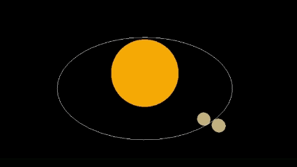
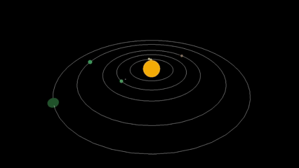
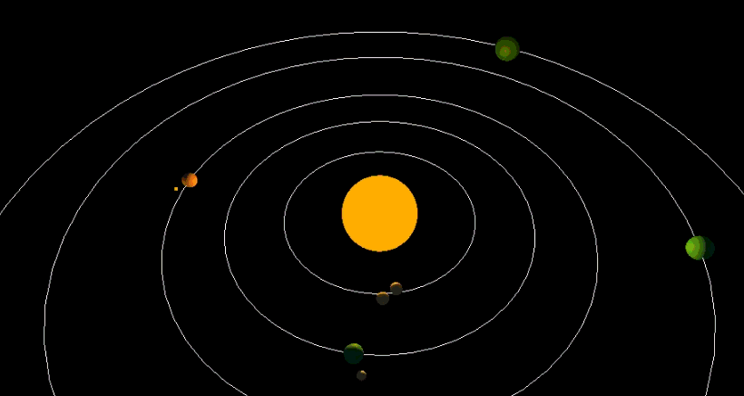
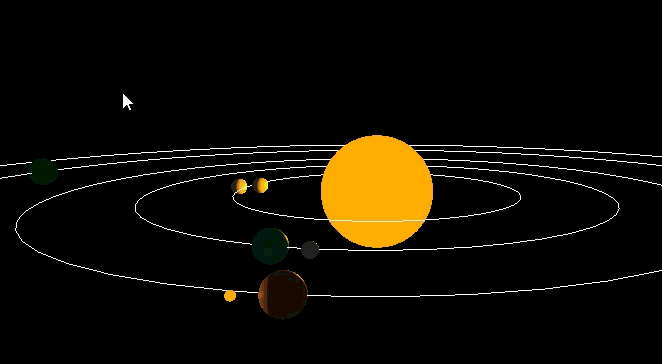
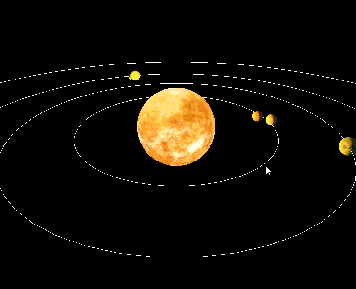
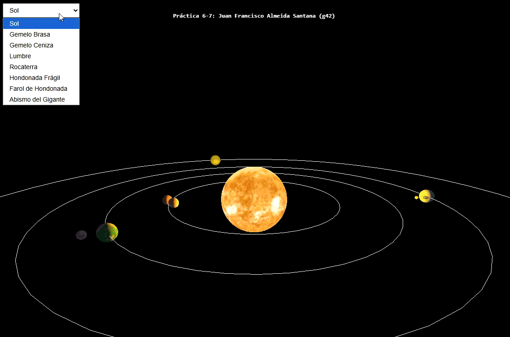
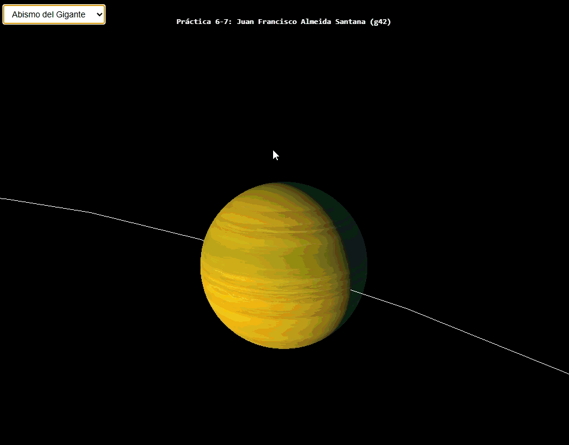

# Juan Francisco Almeida Santana 
## ULPGC curso 2026/27 - Grado en Ingeniería Informática

Este proyecto constituye de la entrega de las prácticas 6 y 7 de la asignatura de Informática Grafica, impartida por la Escuela de Ingeniería Informática (EII) y consta de la creación de un sistema planetario mediante Three.js

En este caso, se ha optado por imitar el sistema planetario que se explora en el videojuego "Outer Wilds".

Puedes [probar esta recreación en este enlace](https://codesandbox.io/p/sandbox/ig-s6-forked-tqp8n9) a CodeSandbox.


## Indice

1) [Creación del sistema solar](#creación-del-sistema-solar)
2) [Luces y sombras en el sistema planetario](#luces-y-sombras-del-sistema-planetario)
3) [Texturas para el sistema planetario](#texturas-para-el-sistema-planetario)
4) [Cambios de perspectiva y movimiento en el sistema](#cambios-de-perspectiva-y-movimiento-en-el-sistema)
5) [Referencias y conversaciones con IA](#referencias-y-conversaciones-con-ia)


---

### Creación del sistema solar

El sistema solar donde se desarrolla Outer Wilds está formado por diferentes planetas y lunas con un gran sol en su centro:

1) Los planetas más cercanos al Sol son dos planetas "Gemelo Brasa" y "Gemelo Ceniza", dos planetas que giran entre sí y giran juntos en torno al Sol
2) El siguiente planeta es el planeta de donde procede el personaje principal, "Lumbre", que cuenta con una luna, "Rocaterra"
3) El siguiente planeta es un planeta llamado "Hondonada Frágil", al rededor del cual gira una muy pequeña estrella llamada "Farol de Hondonada"
4) El 5 planeta de este sistema planetario es un grán planeta gaseoso llamado "Abismo del Gigante"
5) El último planeta del sistema solar es llamado "Espinoscuro"

Nota: En el videojuego existen otros cuerpos y elementos que forman parte del sistema solar (existe un agujero blanco un poco más alla de Espinoscuro y hay un cometa que gira alrededor del sol con una órbita muy excéntrica llamado "El Intruso") pero se han obviado en esta representación.

Para la realización de esta tarea se han utilizado las funciones y elementos proporcionados en el script 7 del guión de la práctica 6, salvo por unas ligeras modificaciónes en las funciones Luna() y animationLoop(), en la que se añade el parámetro de fase a la función para poder controlar la posición en la que empieza la luna a orbitar a su planeta.

```js
function Luna(planeta, radio, dist, vel, col, angle, fase = 0) {
  var pivote = new THREE.Object3D();
  pivote.rotation.x = angle; //si no nulo, rotación suera de plano
  planeta.add(pivote);
  var geom = new THREE.SphereGeometry(radio, 30, 30);
  var mat = new THREE.MeshBasicMaterial({ color: col });
  var luna = new THREE.Mesh(geom, mat);
  luna.userData.dist = dist;
  luna.userData.speed = vel;
  luna.userData.fase = fase;

  Lunas.push(luna);
  pivote.add(luna);
}

...

function animationLoop() {
  
  ...

  for (let object of Lunas) {
    object.position.x =
      Math.cos(timestamp * object.userData.speed + object.userData.fase) * object.userData.dist;
    object.position.z =
      Math.sin(timestamp * object.userData.speed + object.userData.fase) * object.userData.dist;
  }

  ...
}
```

Esto se ha implementado principalmente porque para poder añadir correctamente a los gemelos "Brasa" y "Ceniza" de forma que orbitaran entre ellos, se ha optado por crear un planeta de dimensiones muy pequeñas e invisible, de forma que estos dos planetas se implementan como lunas que orbitan a este planeta invisible (se añadió el parámetro de fase para que uno de los dos comience orbitando al "planeta" desde el lado opuesto al otro y nunca lleguen a chocar o a solaparse dado que orbitan a la misma velocidad y distancia).



De esta manera se consigue el efecto de que son dos planeas que orbitan entre ellos mientran orbitan juntos al Sol.

El resto de planetas y lunas se añaden usando las funciones básicas de Planeta() y Luna().



---

### Luces y sombras en el sistema planetario

El siguiente paso consiste en lograr que el Sol y el Farol de Hondonada den luz a los cuerpos celestes a su alrededor, y que estos tengan sombras y den sombra a los cuerpos que se pongan detrás suyo, para esto se han utilizado los ejemplos del guión de la práctica 7.

Para esto se ha implementado una función crearFuenteDeLuz() que crea una fuente de luz puntual dado un objeto en la escena, y se ha incluido dentro de la función Estrella().

```js
function crearFuenteDeLuz(cuerpo, {
  color = 0xffffff,
  intensidad = 1,
  distancia = 0,
  decay = 2,
  sombras = true,
} = {}) {
  const luz = new THREE.PointLight(color, intensidad, distancia, decay);
  luz.position.set(0, 0, 0);
  luz.castShadow = sombras;

  if (sombras) {
    luz.shadow.mapSize.set(2048, 2048);
    luz.shadow.camera.near = 1;
    luz.shadow.camera.far = 300;
    luz.shadow.bias = -0.0005;
  }

  cuerpo.add(luz);

  const mat = cuerpo.material;
  if (mat) {
    if (mat.emissive) {
      mat.emissive.set(color);
      mat.emissiveIntensity = 1;
    } else {
      mat.color.set(color);
    }
  }

  if (sombras) cuerpo.castShadow = false;
  return luz;
}

...

function Estrella(rad, col) {
  let geometry = new THREE.SphereGeometry(rad, 50, 50);
  let material = new THREE.MeshBasicMaterial({ color: col });
  estrella = new THREE.Mesh(geometry, material);

  crearFuenteDeLuz(estrella, {
    color: col,
    intensidad: 4,
  });

  scene.add(estrella);
}
```



Además se ha utilizado esta nueva función para lograr que el Farol de Hondonada produzca luz debido a que en el juego, es un planeta volánico que produce luz como una estrella.

```js
// Farol de Hondonada
Luna(Planetas[2], 1, 9, 0.06 * TIME_SCALE, 0x8b4a2b, 0);

crearFuenteDeLuz(Lunas[3], {
  color: 0xffaa00,
  intensidad: 2,
  distancia: 30,
  decay: 2,
  sombras: false,
});
```



En el video anterior se puede observar un pequeño seguimiento a la órbita de Hondonada Frágil y la luz generada por el Farol de Hondonada.

---

### Texturas para el sistema planetario

Tras una búsqueda exhaustiva por internet y con ayuda de IA, se ha visto imposible utilizar texturas completamente fieles a los planetas del videojuego pùesto a que no existen publicaciones al respecto. Realmente los planetas tienen muchas irregularidades de terreno exageradas (grandes montañas, construcciones gigantes sobre ellos o grandes volcanes) por lo que se ha optado por buscar texturas lo más similares posibles a cada planeta.

---

Así mismo, debido a la gran complejidad que suponía implementar "Espinoscuro" dado que es un planeta formado prácticamente por raíces y ramas gigantes, siendo un planeta prácticamente hueco, y generarlo iba a ser un proceso muy costoso con herramientas que no se habían visto en la asignatura, se decidio eliminar de la implementación, dejando el sistema solar con todos sus cuerpos celestes hasta el "Abismo del Gigante".

---

Las referencias a todas las texturas y la conversación con Claude Sonnet 5.5 se incluye en el apartado de referencias del repositorio, al final de este archivo.

Para implementar cada una de las texturas primero se incluyeron en el proyecto en el directorio /src/assets/, para luego instanciarlas como constantes en el código mediante un textureLoader

```js
const sol = textureLoader.load("./assets/01_sol.jpg");
const gemelo_brasa = textureLoader.load("./assets/02_gemelo_brasa.jpg");
const gemelo_ceniza = textureLoader.load("./assets/03_gemelo_ceniza.jpg");
const lumbre = textureLoader.load("./assets/04_lumbre.png");
const rocaterra = textureLoader.load("./assets/05_rocaterra.jpg");
const hondonada_fragil = textureLoader.load("./assets/06_hondonada_fragil.png");
const farol_de_hondonada = textureLoader.load("./assets/07_farol_de_hondonada.jpg");
const abismo_del_gigante = textureLoader.load("./assets/08_abismo_del_gigante.png");
```

Luego se modificaron las funciones Estrella(), Planeta() y Luna() para que pudiesen aceptar el parámetro de textura y se aplicase al objeto en cuestion

```js
Estrella(20, 0xffaa00, sol);

// Centro de los Gemelos
Planeta(0.001, 50, 0.0212 * TIME_SCALE, 0xffffff, 1, 1);
Planetas[0].material.visible = false;

// Lumbre
Planeta(3.5, 80,  0.0105 * TIME_SCALE, 0x3f8f5a, 1, 1, lumbre);

// Hondonada Frágil
Planeta(3.5, 110, 0.0065 * TIME_SCALE, 0x8a6d5a, 1, 1, hondonada_fragil); 

// Abismo del Gigalnte
Planeta(5,   160, 0.0037 * TIME_SCALE, 0x2e8b57, 1, 1, abismo_del_gigante); 

// Gemelo Brasa
Luna(Planetas[0], 3, 4,  0.052 * TIME_SCALE, 0xc2b280, 0, 0, gemelo_brasa); 
// Gemelo Ceniza
Luna(Planetas[0], 3, 4,  0.052 * TIME_SCALE, 0xc2b280, 0, Math.PI, gemelo_ceniza); 

// Rocaterra
Luna(Planetas[1], 2, 10, 0.070 * TIME_SCALE, 0x9e9e9e, 0, 0, rocaterra); 
// Farol de Hondonada
Luna(Planetas[2], 1, 9, 0.06 * TIME_SCALE, 0x8b4a2b, 0, 0, farol_de_hondonada); 


crearFuenteDeLuz(Lunas[3], {
  color: 0xffaa00,
  intensidad: 2,
  distancia: 30,
  decay: 2,
  sombras: false,
});

```



No obstante, para poder apreciar mejor la textura de cada planeta, sería mucho mejor poder seguir el planeta que deseamos observar o incluso movernos por el sistema planetario

---

### Cambios de perspectiva y movimiento en el sistema

Actualmente la visualización en el sistema está centrada en el sol del sistema planetario, si queremos cambiar de planeta al que observamos, en primer lugar, debemos crear un selector de planetas incluyendo a todos los planetas del sistema

Además necesitamos diferentes variables donde almacenaremos la posición inicial de la cámara y la posición actual (que variará conforme vamos cambiando de planetas) y una función que se encargue de realizar el enfoque hacia el planeta objetivo

```js
let objetivo = null;
let posObjetivo = new THREE.Vector3();
let camaraInicial = null;
let targetInicial = null;

function crearSelector() {
  camaraInicial = camera.position.clone();
  targetInicial = camcontrols.target.clone();

  const cuerpos = [
    { nombre: "Sol",                 obj: estrella },
    { nombre: "Gemelo Brasa",        obj: Lunas[0] },
    { nombre: "Gemelo Ceniza",       obj: Lunas[1] },
    { nombre: "Lumbre",              obj: Planetas[1] },
    { nombre: "Rocaterra",           obj: Lunas[2] },
    { nombre: "Hondonada Frágil",    obj: Planetas[2] },
    { nombre: "Farol de Hondonada",  obj: Lunas[3] },
    { nombre: "Abismo del Gigante",  obj: Planetas[3] },
  ];

  const select = document.createElement("select");
  select.style.cssText =
    "position:absolute;top:10px;left:10px;z-index:10;padding:6px 10px;font-size:14px;";
  cuerpos.forEach((c, i) => select.add(new Option(c.nombre, i)));
  select.addEventListener("change", () => enfocar(cuerpos[select.value].obj));
  document.body.appendChild(select);
}

function enfocar(obj) {
  if (obj === estrella) {
    // Vista general original
    objetivo = null;
    camcontrols.target.copy(targetInicial);
    camera.position.copy(camaraInicial);
    camcontrols.minDistance = 0;
  } else {
    objetivo = obj;
    const radio = obj.geometry.parameters.radius;
    obj.getWorldPosition(posObjetivo);
    camcontrols.target.copy(posObjetivo);
    // Cámara cerca del cuerpo, proporcional a su tamaño
    camera.position
      .copy(posObjetivo)
      .add(new THREE.Vector3(0, radio * 1.5, radio * 4));
    camcontrols.minDistance = radio * 1.5; // evita meter la cámara dentro del cuerpo
  }
  camcontrols.update();
}
```

Las posiciones se inicializan al crear el selector y en la función de enfoque usaremos la posición inicial que guardamos al principio (que es el sol, y siempre está en el mismo sitio, por lo que ahorramos calcularla si la guardamos) pero si es otro planeta, tendremos que calcular en cada iteración de render la posición del planeta que estamos observando (debido a que todos los planetas están en movimiento, a diferencia del sol).

Crearemos el selector después de la llamada a init y antes de la llamada a animationLoop, donde nos encargaremos de realizar el seguimiento del planeta.

```js
function animationLoop() {

  ...

  if (objetivo) {
    objetivo.getWorldPosition(posObjetivo);
    const desplazamiento = posObjetivo.clone().sub(camcontrols.target);
    camera.position.add(desplazamiento);
    camcontrols.target.copy(posObjetivo);
  }
  camcontrols.update();

  renderer.render(scene, camera);
}
```



Con esto podremos cambiar de planetas mediante un selector, pero nos quedaría poder movernos libremente por el sistema solar, para ello incluiremos una nueva opción en el selector: "Nave espacial" y usaremos FlyControls.

Para ello primero debemos importar FlyControls y posteriormente crear sus variables relacionadas en la función init, declarandolas antes junto a todas las variables globales.

```js
import { FlyControls } from "three/examples/jsm/controls/FlyControls";

...

let flyControls;
let modoNave = false;
const reloj = new THREE.Clock();

...

funciton init() {

  ...

  flyControls = new FlyControls(camera, renderer.domElement);

  flyControls.movementSpeed = 30; 
  flyControls.rollSpeed = 0.5; 
  flyControls.dragToLook = true;
  flyControls.autoForward = false; 
  flyControls.enabled = false;

  ...
}
```

Hemos declarado una variable para determinar el modo de la cámara, si es "Modo nave" o no, este valor se ajusta en función de la selección realizada en el selector.

```js
function crearSelector() {
  camaraInicial = camera.position.clone();
  targetInicial = camcontrols.target.clone();

  const cuerpos = [
    { nombre: "Sol",                 obj: estrella },
    { nombre: "Gemelo Brasa",        obj: Lunas[0] },
    { nombre: "Gemelo Ceniza",       obj: Lunas[1] },
    { nombre: "Lumbre",              obj: Planetas[1] },
    { nombre: "Rocaterra",           obj: Lunas[2] },
    { nombre: "Hondonada Frágil",    obj: Planetas[2] },
    { nombre: "Farol de Hondonada",  obj: Lunas[3] },
    { nombre: "Abismo del Gigante",  obj: Planetas[3] },
    { nombre: "Nave Espacial",       nave: true },
  ];

  const select = document.createElement("select");
  select.style.cssText =
    "position:absolute;top:10px;left:10px;z-index:10;padding:6px 10px;font-size:14px;";
  cuerpos.forEach((c, i) => select.add(new Option(c.nombre, i)));

  select.addEventListener("change", () => {

    let cuerpo = cuerpos[select.value]

    if (cuerpo.nave) {
      activarNave();
    } else {
      desactivarNave();
      enfocar(cuerpo.obj);
    }

  });

  document.body.appendChild(select);
}
```

Se añade ua opción más al selector y el listener para el cambio de modo de visualización, comprobamos si el cuerpo al que cambiamos es la nave o no, si es la nave llamamos a una función activarNave(), y si no, realizamos el comportamiento de antes y nos aseguramos de que la nave esté desactivada llamando al método que la desactiva, desactivarNave().

```js
function activarNave() {
  if (modoNave) return;
  camera.lookAt(camcontrols.target); 
  objetivo = null; 
  camcontrols.enabled = false;
  flyControls.enabled = true;
  modoNave = true;
}

function desactivarNave() {
  if (!modoNave) return;
  modoNave = false;
  flyControls.enabled = false;
  camcontrols.enabled = true;
  camera.up.set(0, 1, 0); 
}
```

Estas funciones se encargan de activar/desactivar la nave y los controles de camara normales, por último debemos considerar la vista desde la nave y actualizar la visualización de FlyControls desde animationLoop(). Para ello añadimos una condición donde actualizamos la vista de FlyControls o la de la cámara convencional en función de si estamos en "modo nave" o no.

```js
function animationLoop() {
  timestamp = (Date.now() - t0) * accglobal;
  const delta = reloj.getDelta();

  ...

  if (modoNave) {
    flyControls.update(delta);
  } else {
    if (objetivo) {
      objetivo.getWorldPosition(posObjetivo);
      const desplazamiento = posObjetivo.clone().sub(camcontrols.target);
      camera.position.add(desplazamiento);
      camcontrols.target.copy(posObjetivo);
    }
    camcontrols.update();
  }

  renderer.render(scene, camera);
}
```



---

### Referencias y conversaciones con IA

Para la elaboración de esta tarea se ha utilizado herramientas de IA a modo de ayuda en la implementación de distintas funcionalidades y para búsqueda de texturas para los planetas, así como para esbozar los tamaños y dimensiones de las órbitas y los planetas del sistema a raíz de referencias del videojuego

---

#### Referencias de las texturas

Texturas del Sol, Gemelo Brasa, Gemelo Ceniza y Rocaterra: [Solar System Scope](https://www.solarsystemscope.com/textures/)

Texturas de Lumbre y Hondonada Frágil: [Screaming Brain Studios](https://screamingbrainstudios.itch.io/planet-texture-pack-1)

Textura del Abismo del Gigante: [OpenGameArt.org](https://opengameart.org/content/planetary-textures-2048x1024?page=2)

- Nota: La textura utilizada del pack Planetary Textures fue modificada en [Affinity](https://www.affinity.studio/es_es) para adaptarse mejor al Abismo del Gigante.

Textura del Farol de Hondonada: [NASA/SDO/Goddard Space Flight Center](https://svs.gsfc.nasa.gov/11136)

---

#### Referencia de fragmentos de código originales y funciones originales

[Guiones de las prácticas 6 y 7 de Informática Gráfica](https://github.com/otsedom/otsedom.github.io/tree/main/IG)

---

#### Conversaciones con Inteligencia Artificial

Conversacion para estimación de las órbitas y tamaños de los planetas: [Enlace](https://claude.ai/share/43f84659-3e32-46d0-aec8-498467853a9d)

Conversación para ayuda en implementación de luces: [Enlace](https://claude.ai/share/5a2f3bfc-cb03-408a-b06d-e21c854f07b3)

Conversación para búsqueda de texturas en internet: [Enlace](https://claude.ai/share/ff57c3b6-4ed3-4ba0-8449-699fdf2f0966)

Conversación para ayuda en el desarrollo del cambio de punto de vista: [Enlace](https://claude.ai/chat/a168e5a7-bf29-490f-8caa-4f5fe0807ad2)

---